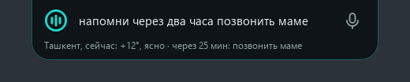
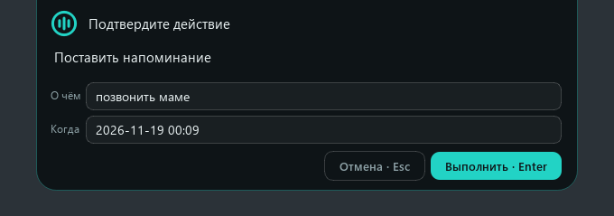

# Ovoz — голосовой ассистент для Windows

Ovoz («голос» по-узбекски) превращает речь в текст и действия в любом приложении Windows 10/11:
диктует в поле под курсором, правит выделенный текст по голосовой инструкции и выполняет команды —
погода, заметки, напоминания, письма, события. Понимает русский, узбекский (латиница) и английский.

**[Скачать последнюю версию](https://github.com/ziyoplay/ovoz-releases/releases/latest)** — файл `Ovoz-Setup-<версия>.exe`.

## Установка

Python и другие программы ставить не нужно — хватит одного файла.

1. Откройте [страницу последнего релиза](https://github.com/ziyoplay/ovoz-releases/releases/latest) и скачайте
   `Ovoz-Setup-<версия>.exe`.
2. Запустите его. Windows покажет синее окно «Система Windows защитила ваш компьютер»: так SmartScreen встречает
   любую программу без платной цифровой подписи, а у установщика Ovoz её нет. Нажмите **«Подробнее»**, затем
   **«Выполнить в любом случае»**.
3. Пройдите установку. Права администратора не нужны: Ovoz ставится в вашу личную папку и появляется в меню
   «Пуск». По галочкам — ярлык на рабочем столе и запуск вместе с Windows.
4. При первом запуске откроется мастер: проверьте микрофон и вставьте ключ Groq (как его получить — ниже).
   После этого Ovoz свернётся в значок возле часов.

Нужна 64-разрядная Windows 10 (версия 1809 или новее) или Windows 11.

## Как пользоваться

| Режим | Клавиши по умолчанию | Что делает |
|---|---|---|
| Диктовка | удерживать `Ctrl+Win` | Говорите — после отпускания очищенный текст вставится туда, где курсор |
| Правка | выделить текст, удерживать `Ctrl+Alt+E` | Скажите «сделай короче», «переведи на английский» — выделение заменится |
| Команда | удерживать `Ctrl+Shift` | «Какая погода завтра», «напомни в 18:00 позвонить маме», «открой блокнот» |
| Командная строка | коротко нажать `Ctrl+Shift` или кликнуть по значку в трее | Ввести команду текстом |
| «Без рук» | дважды быстро нажать клавиши режима | Запись идёт сама; остановка — повторное нажатие или тишина |

Любое действие, кроме ответа на вопрос, сначала показывает карточку: `Enter` — выполнить, `Esc` — отменить.
Ovoz ничего не отправляет сам: письмо и сообщение открываются как черновики.

## Бесплатный ключ Groq

Распознавание и языковая модель работают либо на вашем компьютере (медленнее, зато приватно), либо в облаке
Groq (1–3 секунды). Для облака нужен бесплатный ключ:

1. Зайдите на [console.groq.com](https://console.groq.com) и войдите (Google или почта).
2. Раздел **API Keys** → **Create API Key** → скопируйте ключ (он показывается один раз).
3. Вставьте его в мастере первого запуска или позже: значок Ovoz → «Настройки».

Ключ хранится в Windows Credential Manager, а не в файле.

## Обновление

Ovoz сам проверяет новые версии — при запуске и раз в сутки. Когда версия вышла, на острове появляется строка
«Доступна версия …», а в меню значка — пункт «Обновить до версии …». Щёлкните — увидите, что нового, и кнопки
«Обновить», «Позже» и «Пропустить эту версию». Без вашего щелчка ничего не скачивается и не ставится.
Перед установкой Ovoz проверяет цифровую подпись обновления; не сошлась — обновление не ставится.
Настройки и ключи при обновлении сохраняются.

## Удаление

Параметры Windows → Приложения → Установленные приложения → Ovoz → «Удалить». Появится окно с галочкой
«Удалить настройки и журнал». По умолчанию она выключена: настройки останутся на компьютере и пригодятся,
если вы поставите Ovoz снова. С галочкой удаляются и настройки с журналом, и сохранённые ключи.
Если вы выбирали распознавание «На этом компьютере», скачанная модель остаётся в папке
`%USERPROFILE%\.cache\huggingface` — её можно удалить вручную.

## Приватность

- Звук на диск не сохраняется никогда. Микрофон открыт, только пока идёт запись.
- Что уходит в облако, зависит от вашего выбора в настройках, и Ovoz прямо пишет об этом в строке
  «Куда уходят данные».
- Журнал «что сказано → что сделано» хранится только на вашем компьютере; его можно выключить и очистить.

## Лицензия

Ovoz распространяется бесплатно по лицензии [MIT](LICENSE). В установщик входят сторонние библиотеки под
собственными лицензиями: Qt и PySide6 — LGPL-3.0 (лежат отдельными файлами в папке `_internal\PySide6`, их можно
заменить своей сборкой; исходный код — на [code.qt.io](https://code.qt.io)); faster-whisper, CTranslate2,
ONNX Runtime — MIT; NumPy — BSD-3-Clause; requests, cryptography — Apache-2.0.

Вопросы и ошибки — в разделе [Issues](https://github.com/ziyoplay/ovoz-releases/issues).
